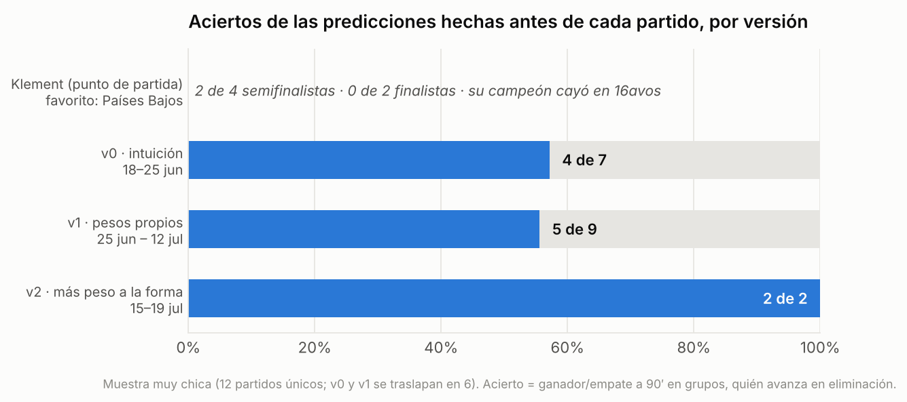
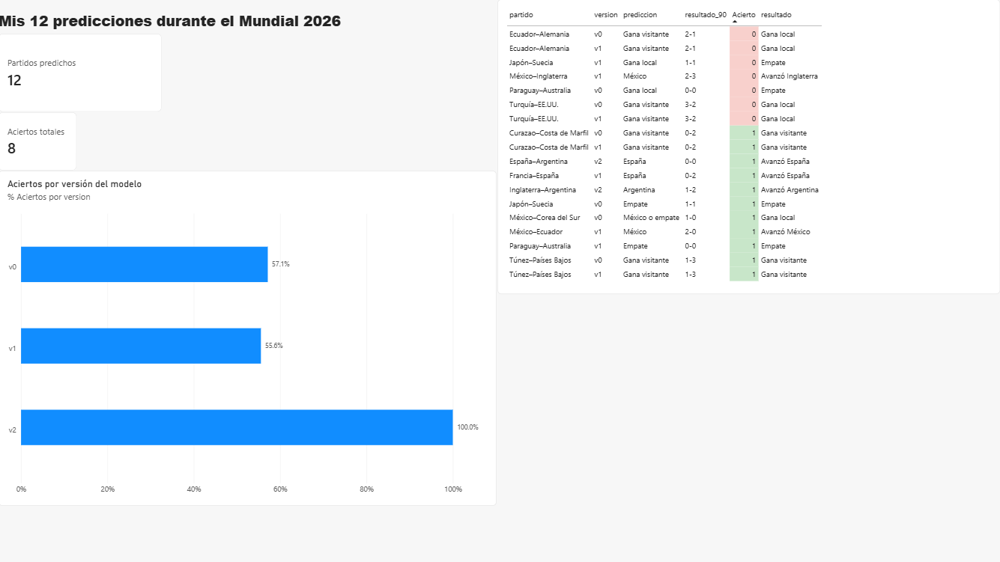
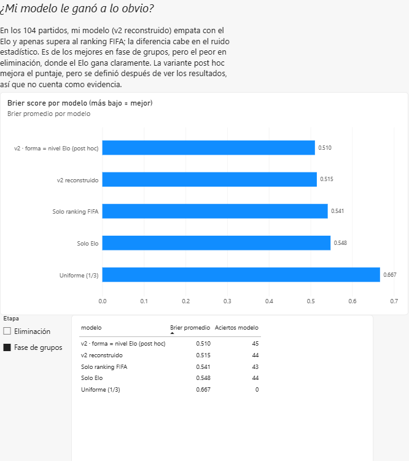
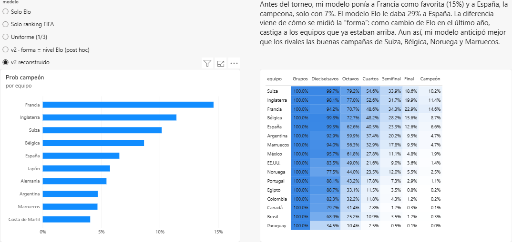
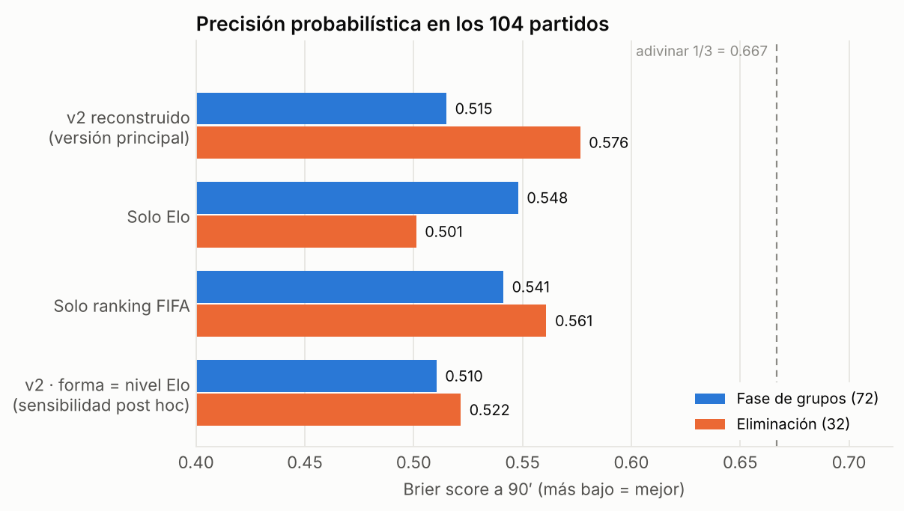
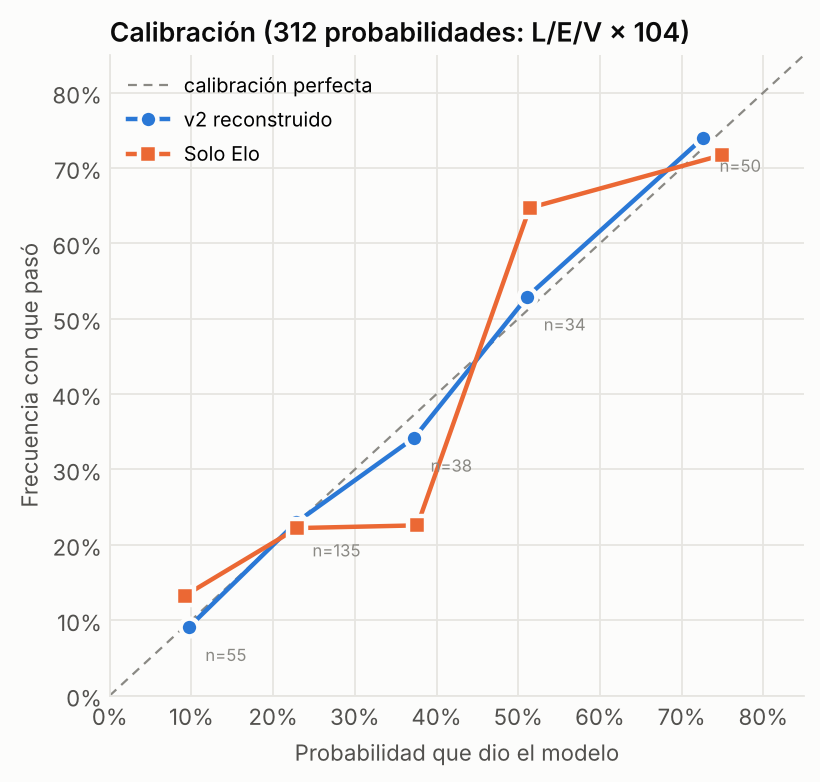
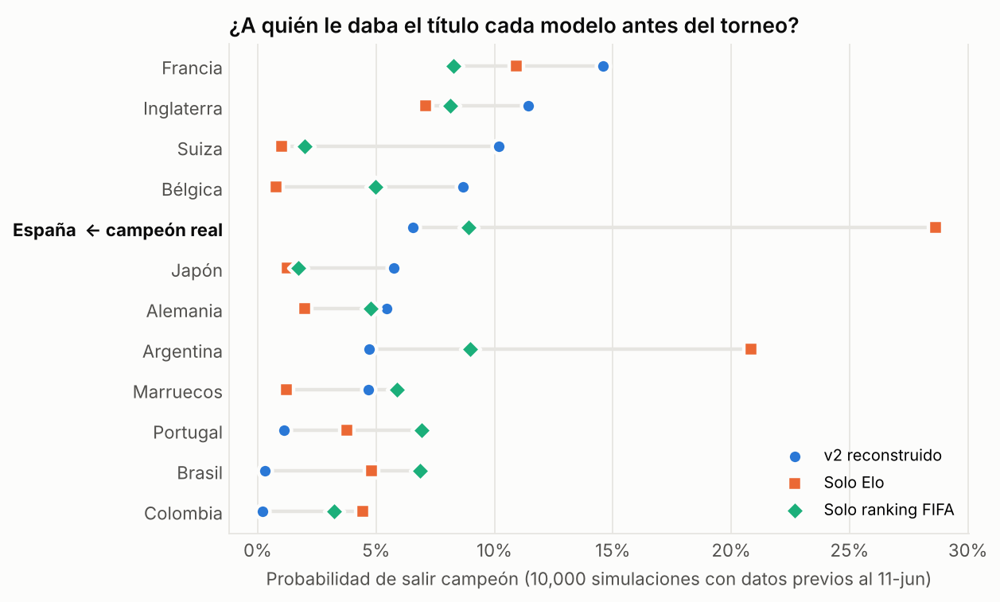
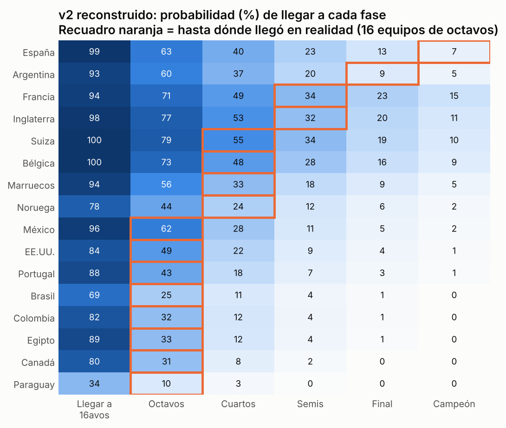

# ¿Le atinó mi modelo al Mundial 2026?

Evaluación honesta de un modelo de predicción del Mundial 2026 que construí y ajusté **durante** el torneo, comparado contra rivales simples: el ranking FIFA y el Elo.

**Resultado en una línea:** mis 12 predicciones hechas antes de cada partido acertaron 8. La versión final del modelo, reconstruida con datos previos al torneo, **no le gana de forma clara al ranking FIFA ni al Elo** en los 104 partidos.



## Tablero en Power BI

El archivo [`powerbi/Mundial2026.pbix`](powerbi/Mundial2026.pbix) tiene 3 páginas, todas con filtros interactivos. Lo arma un modelo estrella: 7 tablas en `powerbi/datos/` (3 de dimensiones y 4 de hechos), más una tabla extra con las predicciones por versión.

| Página | Qué responde |
|---|---|
| **Mis predicciones** | ¿Cuántas acerté y en qué versión del modelo? |
| **Modelo vs rivales** | ¿Le gané al ranking FIFA y al Elo? (filtro por fase de grupos / eliminación) |
| **Simulación** | ¿Quién era favorito antes del torneo, según cada modelo? |





## La historia

| Etapa | Qué era | Qué pasó |
|---|---|---|
| **Klement** | Modelo econométrico de Joachim Klement (PIB per cápita, población, temperatura, anfitrión, puntos FIFA) | Campeón: Países Bajos, eliminado en dieciseisavos (penales contra Marruecos). De lo que publicó: 2 de 4 semifinalistas (España, Inglaterra), 0 de 2 finalistas (Países Bajos, Portugal) y ningún cruce acertado (Japón eliminaba a Brasil en 16avos; Portugal a Argentina en cuartos) |
| **v0** (18–25 jun) | Predicciones a intuición, sin puntajes | 4 de 7 |
| **v1** (25 jun) | Fórmula propia: 20% FIFA, 20% jugadores en ligas top 5, 15% edad, 10% continuidad del técnico, 25% forma, 10% clima/altitud | 5 de 9 |
| **v2** (15 jul) | Igual, pero forma 30% y edad 10% | 2 de 2 (semifinal Argentina–Inglaterra y final) |

España fue campeona: le ganó 1-0 a Argentina en tiempo extra (19 de julio, MetLife Stadium).

## Qué se evaluó

1. **Las 12 predicciones reales.** Son las que quedaron registradas antes de cada partido. Se evalúa lo que se predijo en su momento, con los errores de cuenta incluidos (ver abajo).
2. **El modelo v2 reconstruido.** Usa la misma fórmula de la v2, pero cada variable se mide con datos objetivos disponibles antes del 11 de junio de 2026. Se aplicó a los 104 partidos y a una simulación Monte Carlo de 10,000 torneos.

Rivales en los dos casos: **solo ranking FIFA**, **solo Elo** y **adivinar 1/3**.

**Reglas de las métricas**
- **Acierto:** en grupos se compara el resultado a 90′ (gana local, empate o gana visitante). En eliminación se compara **quién avanzó**; por eso la final cuenta como acierto aunque iba 0-0 a los 90′.
- **Brier y log-loss:** siempre se miden contra el **resultado a 90′**, en las dos fases.

**La forma reconstruida no es la forma original.** En la v2 original, la variable de mayor peso (30%) era la forma *dentro* del torneo, que no existe antes de que empiece. La reconstrucción la reemplaza por el **cambio de Elo en los 12 meses previos**. Fue una decisión de la reconstrucción, tomada antes de evaluar, y por eso es la **versión principal**.

### Cómo se miden las variables del v2 reconstruido

| Variable | Peso | Regla (escala 1–10) | Fuente |
|---|---|---|---|
| Ranking FIFA | 20% | `10 − 9·(rank−1)/84` | Ranking FIFA vigente al 11-jun-2026 |
| Top 5 | 20% | `1 + 9·%` de la plantilla en la 1a división de ENG/ESP/ITA/GER/FRA 2025-26 | Plantillas oficiales de 26 jugadores; 1,248 jugadores contados uno por uno |
| Edad | 10% | `10 − 3·|edad − 27|` | Edad promedio de las plantillas oficiales (RotoWire) |
| Continuidad | 10% | `1 + 9·min(meses del técnico, 96)/96` | Fecha de nombramiento del técnico |
| Forma | 30% | Cambio de Elo en los 12 meses previos, reescalado a 1–10 | Elo calculado desde cero con la base de partidos internacionales (martj42) |
| Clima | 10% | `10 − 0.3·|T sede − T casa|` − penalización por altitud (CDMX, Guadalajara); estadios con techo climatizado = 22 °C | Normales climáticas aproximadas |

**Paso de puntaje a probabilidades** (la misma regla para todos los modelos, sin calibrar con 2026): los goles de cada equipo siguen una Poisson con `λ = 1.30·exp(±β·d)`, donde d es la diferencia de puntajes. β se fija para que, en un partido muy desigual (percentil 95 de las diferencias), el favorito espere 6 veces más goles que el rival. En eliminación, un empate a 90′ pasa a tiempo extra (λ/3) y luego a penales 50/50.

## Resultados

### 1. Las 12 predicciones reales

- **8 de 12 aciertos.** Los fallos fueron Ecuador–Alemania, Japón–Suecia (v1), Turquía–EE.UU. y México–Inglaterra.
- **El dato limpio es el 8 de 12**, porque no depende de ninguna conversión.
- **El Brier depende de la conversión.** El modelo nunca dio probabilidades. Para calcular un Brier, los puntajes se convierten con una regla calibrada con la propia tabla del chat del 25 de junio. Según el supuesto, el Brier de los 11 partidos con puntaje va de **0.70 a 0.77**, contra 0.667 de adivinar 1/3:

  | Supuesto: el favorito claro espera… | 3x goles | 4x | 6x | 9x |
  |---|---|---|---|---|
  | Brier de mis 11 predicciones | 0.700 | 0.723 | 0.752 | 0.773 |

  Las diferencias de puntaje grandes (−2.7 en Ecuador–Alemania, −3.1 en Túnez–Países Bajos) se convierten en probabilidades muy altas, y dos de ellas fallaron. Esto **mide la conversión tanto como el modelo**, así que no debe leerse como una prueba de que el modelo era sobreconfiado.
- **Errores aritméticos:** al recalcular, tres totales no coincidían con su propia fórmula, y eso cambiaba el favorito en tres partidos:

  | Partido | Predicción emitida | Con la fórmula bien aplicada | Real |
  |---|---|---|---|
  | Paraguay–Australia | Empate | Australia | 0-0 |
  | México–Inglaterra | México | Inglaterra | 2-3 |
  | Francia–España | España (desempate a criterio) | España | 0-2 |

  El empate en Paraguay–Australia fue acierto gracias al error de cuenta, y México–Inglaterra fue fallo por el error. Los errores se compensan y el saldo es cero.

### 2. Modelo v2 reconstruido en los 104 partidos

| Modelo | Brier (90′) | Log-loss | Aciertos |
|---|---|---|---|
| v2 reconstruido | **0.534** | **0.909** | 60 |
| Solo Elo | 0.534 | 0.917 | 64 |
| Solo ranking FIFA | 0.547 | 0.923 | 64 |
| Adivinar 1/3 | 0.667 | 1.099 | — |

- La diferencia contra el ranking FIFA es de −0.013, con IC 95% por bootstrap de [−0.065, +0.039]. **No es significativa.** Contra el Elo, la diferencia es prácticamente cero.
- El v2 reconstruido **fue el mejor en fase de grupos** (0.515) y **el peor en eliminación** (0.576 contra 0.501 del Elo).
- Si el supuesto de "6 veces más goles" se cambia a 4 o a 9, el orden entre modelos no cambia.
- La calibración es buena: cuando el modelo dice 50%, pasa alrededor del 50% de las veces.

**Análisis de sensibilidad post hoc: forma = nivel de Elo.** Después de ver los resultados se probó medir la forma como **nivel** de Elo (qué tan bueno es el equipo) en lugar de **cambio** de Elo (cuánto mejoró). No es la versión principal, por dos razones: se eligió viendo los datos, y usa el propio Elo como 30% del puntaje, así que es natural que se parezca al Elo.

| Comparación (Brier, variante post hoc − rival) | Diferencia | IC 95% (bootstrap) |
|---|---|---|
| vs Solo Elo | −0.020 | [−0.051, +0.011] |
| vs v2 reconstruido (principal) | −0.020 | [−0.056, +0.016] |
| vs Solo ranking FIFA | −0.033 | [−0.066, −0.002] |

Mejora el puntaje (0.534 → 0.514, 65 aciertos) y mejora mucho en eliminación (0.522 contra 0.576), pero **no le gana con claridad al Elo**: el intervalo incluye el cero. Contra el ranking FIFA el intervalo apenas excluye el cero, pero al ser una comparación elegida después de ver los datos, no se toma como evidencia firme.




### 3. Simulación Monte Carlo (10,000 torneos)

| Modelo | Favorito antes del torneo | Probabilidad de España campeona |
|---|---|---|
| v2 reconstruido | Francia (14.6%) | 6.6% (5o lugar) |
| Solo ranking FIFA | Argentina (9.0%) | 8.9% |
| Solo Elo | España (28.6%) | **28.6%** |
| *v2 · forma = nivel Elo (post hoc)* | *Francia (20.2%)* | *17.6%* |

El v2 reconstruido subestimó a España y a Argentina. La causa principal es **cómo se reconstruyó la forma**, no necesariamente tu v2 original. El cambio de Elo mide cuánto mejoró un equipo, no qué tan bueno es: España llegó con su Elo prácticamente igual que un año antes (Δ 0) y Argentina con −14, así que esa medida castiga a quien ya está arriba. Con la forma medida como nivel de Elo (post hoc), España sube a 17.6%. Al mismo tiempo, la versión principal fue la que mejor describió **hasta dónde llegó cada equipo** (log-verosimilitud media de −1.20, contra −1.23 del Elo y −1.32 del FIFA): vio venir las buenas campañas de Suiza, Bélgica, Noruega y Marruecos.




## Conclusiones

1. **Acertar 8 de 12 no es lo mismo que predecir bien.** Las probabilidades implícitas eran sobreconfiadas, y la muestra es demasiado chica para separar habilidad de suerte.
2. **Ajustar el modelo sobre la marcha no se tradujo en una ventaja medible.** La v2 reconstruida empata con el Elo y le gana al ranking FIFA por un margen que cabe en el ruido. La variante post hoc mejora el puntaje, pero tampoco le gana con claridad al Elo.
3. **Lo que sí aporta el modelo:** ve mejor la fase de grupos y las "sorpresas" de equipos medianos.
4. **Lo que falla:** la forma medida como cambio de Elo, que fue una decisión de la reconstrucción, penaliza a los equipos que ya estaban arriba, y eso es lo que más importa en eliminación. Cómo se mide la forma antes del torneo es la pregunta abierta más importante para una siguiente versión.

## Limitaciones

- **Sesgo retrospectivo.** El análisis se hizo después del torneo, conociendo los resultados. Para limitarlo, todas las reglas se fijaron con criterios previos (no ajustando a los resultados), solo se usaron datos con fecha anterior al 11 de junio, el modelo se congeló en un commit antes de correr la evaluación y se probó la sensibilidad al supuesto clave. Aun así, no es lo mismo que una predicción publicada antes del torneo.
- **Los pesos de la v2 se decidieron viendo partidos del Mundial** (la forma subió a 30% y la edad bajó a 10%). Esto se declara, no se corrige.
- **La forma reconstruida no es la original.** La forma dentro del torneo no existe antes de que empiece; el cambio de Elo es un sustituto elegido para la reconstrucción.
- **El Brier de las 12 predicciones reales depende de la regla de conversión** (de 0.70 a 0.77 según el supuesto).
- **Muestras chicas:** 12 predicciones reales y 104 partidos. Los intervalos de confianza son anchos.
- **Fechas aproximadas:** las fechas de registro de las predicciones reales son aproximadas, y algunas se hicieron el mismo día del partido.
- **Variables con datos aproximados:**
  - El **clima** usa normales climáticas de referencia, no un índice medido.
  - Algunas **fechas de nombramiento** de técnicos vienen de conocimiento previo y son aproximadas; en `data/raw/tecnicos_nombramiento.csv` se marca cuáles.
  - El **% top 5** toma el club que aparece en la lista oficial de junio.
- **Simplificaciones de la simulación:**
  - Los goles se modelan con Poisson independientes, sin ajuste por empates ni ventaja de local para los anfitriones.
  - Los desempates de grupo no usan el enfrentamiento directo.
  - La asignación de terceros lugares solo replica la tabla oficial para la combinación real; en las demás usa un emparejamiento válido.
- **Klement:** no se encontró publicado su cuadro completo, solo algunos cruces, los semifinalistas, los finalistas y el campeón citados en prensa. Por eso se evalúa por rondas y no entra en el Brier. Evaluarlo partido por partido queda pendiente.

## Cómo reproducir

```bash
pip install numpy pandas matplotlib nbformat nbconvert ipykernel
python src/evaluacion.py      # métricas + Monte Carlo → resultados/
python src/graficas.py        # 5 gráficas → graficas/
jupyter nbconvert --to notebook --execute evaluacion_mundial2026.ipynb
```

## Estructura

```
data/raw/            predicciones del chat, plantillas (clubes por jugador), técnicos, clima, base internacional (martj42)
data/processed/      mundial2026_partidos.csv: 104 partidos + 12 predicciones
src/elo.py           Elo desde cero (fórmula de eloratings.net)
src/modelo.py        v2 reconstruido y regla de probabilidades
src/simulacion.py    Monte Carlo con calendario y sedes reales
src/evaluacion.py    métricas, bootstrap, sensibilidad
src/graficas.py      gráficas
resultados/          resultados.json, probabilidades_104.csv, puntajes_48_equipos.csv
powerbi/             Mundial2026.pbix, tablas del modelo estrella (datos/) y capturas
```

## Fuentes

- Resultados: [Excélsior](https://www.excelsior.com.mx/deportes/mundial-2026-resultados-72-partidos-fase-grupos), [Wikipedia](https://en.wikipedia.org/wiki/2026_FIFA_World_Cup_knockout_stage), [Ekantipur](https://worldcup.ekantipur.com/schedule), cruzados con [martj42/international_results](https://github.com/martj42/international_results)
- Ranking FIFA: [MLS](https://www.mlssoccer.com/news/fifa-world-rankings-every-team-at-the-world-cup)
- Edades: [RotoWire](https://www.rotowire.com/soccer/article/2026-fifa-world-cup-squad-ages-youngest-oldest-teams-ranked-116813)
- Plantillas: [Wikipedia](https://en.wikipedia.org/wiki/2026_FIFA_World_Cup_squads), [World Cup Ranking](https://worldcupranking.com/blog/world-cup-2026-official-squads-june-3/)
- Klement: [Gulf News (4-jun-2026)](https://gulfnews.com/sport/football/world-cup/economist-who-predicted-last-3-world-cups-correctly-says-ronaldo-will-knock-out-messi-and-netherlands-will-win-1.500563259), [beIN Sports (29-jun-2026)](https://www.beinsports.com/en-us/soccer/fifa-world-cup-2026/articles/how-are-joachim-klement-s-2026-world-cup-predictions-holding-up-brazil-has-already-proven-one-of-them-wrong-and-neymar-didn-t-miss-the-chance-to-respond-2026-06-29)
- Técnicos: [World Cup Ranking](https://worldcupranking.com/blog/world-cup-2026-managers-coaches-guide/), notas de nombramiento enlazadas en `data/raw/tecnicos_nombramiento.csv`

*Autor: Miguel — Lic. en Matemáticas Aplicadas (UJED).*
